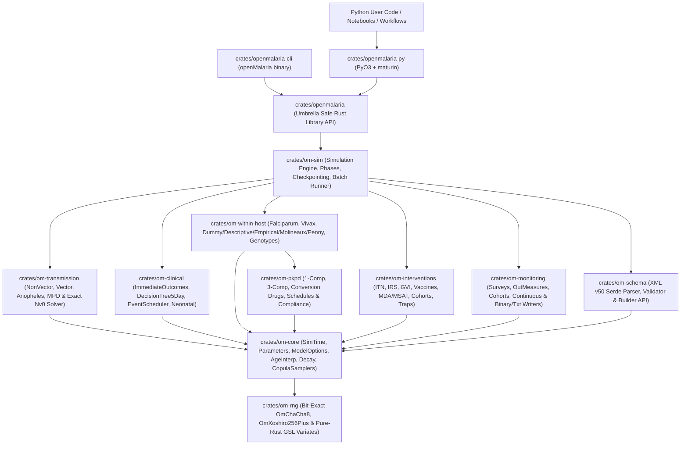
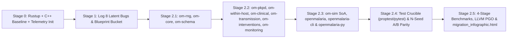

# OpenMalaria Modern Refactor & Safe Rust Library Architecture Plan

## Goal Description

Refactor **OpenMalaria (Schema v50)** from a monolithic, static-singleton C++20 executable (`150` files in [model/](file:///Users/blaarm/git/openmalaria-fork-antigravity/model), `17,548` code LOC / `11,127` comment LOC) into a **modular, extensible, library-first 100% Safe Rust workspace (`#![forbid(unsafe_code)]`)** callable natively from **Python** (`PyO3` + `maturin`), where the **`openMalaria` CLI is a thin sequence of library calls** and every stage is instrumented via the [`migrate-to-rust`](file:///Users/blaarm/git/openmalaria-fork-antigravity/.agents/skills/migrate-to-rust/SKILL.md) telemetry and Profile-Guided Optimization (PGO) pipeline.

Why the current C++ architecture blocks library and Python usage:
- **Process-wide mutable static singletons**: Over 15 subsystems ([sim.h](file:///Users/blaarm/git/openmalaria-fork-antigravity/model/sim.h#L50-L55), [random.cpp](file:///Users/blaarm/git/openmalaria-fork-antigravity/model/util/random.cpp#L27), [CommandLine.cpp](file:///Users/blaarm/git/openmalaria-fork-antigravity/model/util/CommandLine.cpp#L37-L42), [Monitoring.h](file:///Users/blaarm/git/openmalaria-fork-antigravity/model/mon/Monitoring.h#L92), [InterventionManager.h](file:///Users/blaarm/git/openmalaria-fork-antigravity/model/interventions/InterventionManager.h#L90-L102), [ClinicalModel.h](file:///Users/blaarm/git/openmalaria-fork-antigravity/model/Clinical/ClinicalModel.h#L160-L180), [WHFalciparum.h](file:///Users/blaarm/git/openmalaria-fork-antigravity/model/Host/WithinHost/WHFalciparum.h#L146), [CommonWithinHost.cpp](file:///Users/blaarm/git/openmalaria-fork-antigravity/model/Host/WithinHost/CommonWithinHost.cpp#L40-L47)) store simulation configuration and live counters in global `static` state. Two simulations cannot coexist in memory, run in parallel threads, or even re-initialize cleanly in a single Python interpreter process.
- **Heavy C++ build/runtime coupling**: Requires external `xsdcxx` code generation, `xerces-c`, and `libgsl` dynamic linking.
- **Hot-loop heap churn & pointer indirection**: Every human update ([Human.cpp](file:///Users/blaarm/git/openmalaria-fork-antigravity/model/Host/Human.cpp#L248-L250)) and infectiousness reduction ([TransmissionModel.h](file:///Users/blaarm/git/openmalaria-fork-antigravity/model/Transmission/TransmissionModel.h#L275-L277)) allocates and frees four `std::vector<double>` buffers per human per timestep, behind three `std::unique_ptr` virtual dispatches, raw `CommonInfection*` linked lists ([CommonWithinHost.h](file:///Users/blaarm/git/openmalaria-fork-antigravity/model/Host/WithinHost/CommonWithinHost.h#L93)), and per-human `std::map` trees ([Human.h](file:///Users/blaarm/git/openmalaria-fork-antigravity/model/Host/Human.h#L147)).

---

## User Review Required

> [!IMPORTANT]
> **Stage 0 Toolchain & Legacy Baseline Execution Gate (`migrate-to-rust` Contract)**:
> Before executing any build or benchmark commands upon plan approval, please confirm the resolved environment setup and baseline commands below:
> 1. **Rust Toolchain Setup**: `rustc`/`cargo` are not currently installed on this Mac. Upon approval, we will install stable Rust via `rustup-init -y --default-toolchain stable --component clippy llvm-tools-preview` and `maturin`/`pytest`/`numpy` in an isolated `.venv` via `/opt/homebrew/bin/uv`.
> 2. **Legacy C++ Baseline Build Command** (working dir: `/Users/blaarm/git/openmalaria-fork-antigravity`):
>    ```bash
>    cmake -S . -B build -DCMAKE_BUILD_TYPE=Release -DOM_BOXTEST_ENABLE=ON -DOM_CXXTEST_ENABLE=ON && cmake --build build -j8
>    ```
> 3. **Legacy C++ Baseline Verification & Benchmark Commands**:
>    ```bash
>    ctest --test-dir build --output-on-failure -j8
>    ./build/openMalaria --resource-path test --scenario test/scenarioVecFullTest.xml --output build/bench_out.txt --ctsout build/bench_cts.txt
>    ```
> 4. **Coexisting Workspace Layout**: Legacy C++ files (`model/`, `schema/`, `test/`, `unittest/`) remain intact so Stage 0 and Stage 2.4 A/B parity tests can run side-by-side against `./build/openMalaria`.

### Isolating `#![forbid(unsafe_code)]` from Python FFI Glue

Every Rust domain crate (`om-*`), umbrella library crate (`openmalaria`), and CLI binary crate (`openmalaria-cli`) enforces `#![forbid(unsafe_code)]` (`0` `unsafe` blocks across the entire Rust simulation engine and CLI). Because `PyO3`'s `#[pyclass]`/`#[pymethods]` procedural macros expand into CPython C-API FFI glue that uses `unsafe` internally, Python bindings live in a dedicated thin adapter crate (`crates/openmalaria-py`, `<= 400` LOC per file) that contains zero simulation logic and delegates 100% of work to safe `openmalaria` library calls.

---

## Open Questions

All four initial architectural questions (v50 full submodel scope, fine-grained stateful Python API + Rayon batching, root Cargo workspace coexistence, and `rustup` + C++ baseline setup) have been resolved. No blocking ambiguities remain prior to approval.

---

## Stage 1 Architectural Blueprint (6 Sections)

### Section 1: Codebase Audit, Legacy Census & Latent Bugs Discovered

#### Automated Legacy Codebase Census (`before` snapshot preview)

| Directory | Scanned Files | Code LOC | Comment LOC | Comment % | Max File LOC | Files `<= 400` LOC | Max Nesting | Memory/State Hazards |
| :--- | ---: | ---: | ---: | ---: | ---: | ---: | ---: | ---: |
| [model/](file:///Users/blaarm/git/openmalaria-fork-antigravity/model) | 150 | 17,548 | 11,127 | 63.4% | 856 | 92.0% | 11 | 1,188 |
| [contrib/](file:///Users/blaarm/git/openmalaria-fork-antigravity/contrib) | 226 | 18,771 | 4,479 | 23.9% | 2,387 | 95.6% | 15 | 579 |
| [unittest/](file:///Users/blaarm/git/openmalaria-fork-antigravity/unittest) | 25 | 2,909 | 1,297 | 44.6% | 493 | 92.0% | 6 | 320 |

*(Oversized `> 600` LOC monoliths in `model/` that will be decomposed into `<= 400` LOC modules: [AnophelesModel.cpp](file:///Users/blaarm/git/openmalaria-fork-antigravity/model/Transmission/Anopheles/AnophelesModel.cpp) `960` lines, [CalcNvO.cpp](file:///Users/blaarm/git/openmalaria-fork-antigravity/model/Transmission/Anopheles/CalcNvO.cpp) `893` lines, [CMDecisionTree.cpp](file:///Users/blaarm/git/openmalaria-fork-antigravity/model/Clinical/CMDecisionTree.cpp) `804` lines, [ITN.cpp](file:///Users/blaarm/git/openmalaria-fork-antigravity/model/interventions/ITN.cpp) `741` lines, [Deployments.h](file:///Users/blaarm/git/openmalaria-fork-antigravity/model/interventions/Deployments.h) `712` lines, [WHVivax.cpp](file:///Users/blaarm/git/openmalaria-fork-antigravity/model/Host/WithinHost/WHVivax.cpp) `664` lines, [AnophelesModel.h](file:///Users/blaarm/git/openmalaria-fork-antigravity/model/Transmission/Anopheles/AnophelesModel.h) `658` lines.)*

#### 8 Latent Bugs & Undefined Behaviors Uncovered in Legacy C++

1. **Uninitialized EIR Accumulators (Undefined Behavior)** — [TransmissionModel.h](file:///Users/blaarm/git/openmalaria-fork-antigravity/model/Transmission/TransmissionModel.h#L127-L141) & [TransmissionModel.h](file:///Users/blaarm/git/openmalaria-fork-antigravity/model/Transmission/TransmissionModel.h#L466-L474):
   `tsAdultEIR_i`, `tsAdultEIR_l`, `surveyInputEIR_i`, `surveyInputEIR_l`, `surveySimulatedEIR_i`, and `surveySimulatedEIR_l` lack member defaults and are omitted from `TransmissionModel`'s constructor initializer list, yet `surveyEIR()` ([TransmissionModel.h](file:///Users/blaarm/git/openmalaria-fork-antigravity/model/Transmission/TransmissionModel.h#L342-L343)) executes `+=` on them at every warmup timestep.
2. **Pre-Main-Sim EIR Reset Ordering Bug** — [main.cpp](file:///Users/blaarm/git/openmalaria-fork-antigravity/model/main.cpp#L278-L279) & [TransmissionModel.h](file:///Users/blaarm/git/openmalaria-fork-antigravity/model/Transmission/TransmissionModel.h#L175):
   `transmission->summarize()` is invoked *before* `mon::initMainSim()`, when `mon::isReported()` is still `false`, causing `summarize()` to return early at line 175 without zeroing `surveyInputEIR` and `surveySimulatedEIR*` after the 55-year warmup.
3. **Copy-Pasted Debug Assertion Crash in `transientEIRknown`** — [VectorModel.cpp](file:///Users/blaarm/git/openmalaria-fork-antigravity/model/Transmission/VectorModel.cpp#L376-L381):
   Inside `if (simulationMode == transientEIRknown)`, line 381 executes `assert(simulationMode == forcedEIR);`, guaranteeing `abort()` in any non-`NDEBUG` build whenever `transientEIRknown` is used.
4. **Stale Cohort Bitmask Cache on Removal** — [Human.cpp](file:///Users/blaarm/git/openmalaria-fork-antigravity/model/Host/Human.cpp#L131-L134):
   `Human::removeFromCohort(id)` calls `subPopExp.erase(id)` without calling `cohortSet = mon::updateCohortSet(cohortSet, id, false)` (unlike `addToCohort`, `removeFirstEvent`, and `updateCohortSet`), permanently corrupting cohort monitoring attribution for removed hosts.
5. **Pass-by-Value Progress Bug & Signed Overflow** — [main.cpp](file:///Users/blaarm/git/openmalaria-fork-antigravity/model/main.cpp#L54-L61) & [main.cpp](file:///Users/blaarm/git/openmalaria-fork-antigravity/model/main.cpp#L77):
   `print_progress(int lastPercent, ...)` takes `lastPercent` by value rather than `int&`, so `static int lastPercent = -1` in `run()` never updates and `--progress` spams `stderr` on every single timestep; `(sim::now() * 100)` can also overflow 32-bit `int` on long horizons.
6. **Divide-by-Zero UB on Missing Interval / Zero Adults** — [sim.cpp](file:///Users/blaarm/git/openmalaria-fork-antigravity/model/sim.cpp#L35-L88) & [TransmissionModel.h](file:///Users/blaarm/git/openmalaria-fork-antigravity/model/Transmission/TransmissionModel.h#L328-L335):
   If neither `ModelName="base"` nor `<parameters interval="...">` is present, `SimData::interval` remains `0` and `365 / SimData::interval` triggers integer division-by-zero UB; similarly `tsAdultEntoInocs / tsNumAdults` produces `NaN` when `tsNumAdults == 0`, poisoning `surveySimulatedEIR`.
7. **Infinite Resampling Hang When `multStdDev == 0`** — [CommonWithinHost.cpp](file:///Users/blaarm/git/openmalaria-fork-antigravity/model/Host/WithinHost/CommonWithinHost.cpp#L79-L85):
   When `multStdDev == 0.0` (explicitly allowed by [scenario.xsd](file:///Users/blaarm/git/openmalaria-fork-antigravity/schema/scenario.xsd#L272)) and newborn mean mass `< 0.5` kg, `do { hetMassMultiplier = rng.gauss(1.0, 0.0); } while (hetMassMultiplier < minHetMassMult)` loops forever in Release builds.
8. **Uninitialized Struct/Class Fields & Raw Owning Pointers** — [WHVivax.h](file:///Users/blaarm/git/openmalaria-fork-antigravity/model/Host/WithinHost/WHVivax.h#L70-L71) (`UpdResult::isFinished`), [ClinicalEventScheduler.h](file:///Users/blaarm/git/openmalaria-fork-antigravity/model/Clinical/EventScheduler.h#L135) (`previousDensity`), [CommonWithinHost.h](file:///Users/blaarm/git/openmalaria-fork-antigravity/model/Host/WithinHost/CommonWithinHost.h#L93) (`std::list<CommonInfection*>`), and raw `malloc`/`free` arrays in [CalcNvO.cpp](file:///Users/blaarm/git/openmalaria-fork-antigravity/model/Transmission/Anopheles/CalcNvO.cpp#L139-L160).

---

### Section 2: Target Safe Rust Architecture & Module Graph

We eliminate **all** global mutable state by encapsulating simulation configuration into an immutable `Arc<ScenarioContext>` and mutable runtime state into an explicit `Simulation` struct. Multiple independent `Simulation` instances can run concurrently across OS threads (`Send + Sync` configuration, `Rayon` parallel sweeps from Python with GIL released).



#### Modular Extension Points (Prioritizing Future Extendability)

To make adding future biological models effortless without touching existing crates:
- **`WithinHostModel` & `InfectionModel` traits (`om-within-host`)**: Enum dispatch (`WithinHostDispatch`) for built-in fast paths *plus* a `Custom(Box<dyn WithinHostModel + Send>)` variant so researchers can register new parasite species or within-host dynamics via trait implementation.
- **`TransmissionBackend` & `MosquitoLifeCycle` traits (`om-transmission`)**: Cleanly decouples `NonVector`, `AnophelesChitnis`, and `SimpleMPD` emergence dynamics, making future spatial/metapopulation or larval-stage extensions plug-in implementations.
- **`DrugCompartmentModel` trait (`om-pkpd`)**: Uniform interface over 1-compartment, 3-compartment, conversion PK/PD, and future drug models.
- **`CaseManagementPolicy` trait (`om-clinical`)**: Clean separation of pathogenesis triggers from health-system decision trees (`ImmediateOutcomes`, `DecisionTree5Day`, `EventScheduler`).
- **`InterventionComponent` trait & `SimulationObserver` hook (`om-interventions` / `om-sim`)**: Allows custom interventions and live per-step telemetry/callbacks from Rust or Python without editing the core loop.

---

## Proposed Changes

All Rust files in `crates/om-*`, `crates/openmalaria`, and `crates/openmalaria-cli` carry `#![forbid(unsafe_code)]`, complete `//!` and `///` rustdoc with runnable doc-tests, and adhere to a **`<= 400` LOC target per file** (hard ceiling `600` LOC).

### Workspace & Build Configuration

#### [NEW] [Cargo.toml](file:///Users/blaarm/git/openmalaria-fork-antigravity/Cargo.toml)
Defines the 11-crate Cargo workspace (`om-rng`, `om-core`, `om-schema`, `om-pkpd`, `om-within-host`, `om-clinical`, `om-transmission`, `om-interventions`, `om-monitoring`, `om-sim`, `openmalaria`, `openmalaria-cli`, `openmalaria-py`) and PGO-ready `[profile.release]` (`opt-level = 3`, `lto = "fat"`, `codegen-units = 1`, `panic = "abort"`).

#### [NEW] [pyproject.toml](file:///Users/blaarm/git/openmalaria-fork-antigravity/pyproject.toml)
Configures `maturin` (`bindings = "pyo3"`, `manifest-path = "crates/openmalaria-py/Cargo.toml"`, `module-name = "openmalaria._core"`) and pure-Python package `python/openmalaria/` with type stubs (`__init__.pyi`) and optional `numpy`/`pandas`/`polars` helpers.

---

### Layer 1: Deterministic PRNG, Core Primitives & Schema v50 (`om-rng`, `om-core`, `om-schema`)

| Legacy File & Symbol (C++) | Target Rust Module & Type/Fn | Transformation & LOC Target |
| :--- | :--- | :--- |
| [contrib/chacha.h](file:///Users/blaarm/git/openmalaria-fork-antigravity/contrib/chacha.h) `ChaCha<8>` | `crates/om-rng/src/chacha.rs::MasterRng` | Bit-exact safe `[u32; 16]` ChaCha8 with OM custom IV; `<= 220` LOC |
| [model/util/xoshiro.h](file:///Users/blaarm/git/openmalaria-fork-antigravity/model/util/xoshiro.h) `Xoshiro256P` | `crates/om-rng/src/xoshiro.rs::LocalRng` | Bit-exact safe `[u64; 4]` Xoshiro256+ (`Copy`/value state); `<= 180` LOC |
| [model/util/random.h](file:///Users/blaarm/git/openmalaria-fork-antigravity/model/util/random.h) `RNG<T>` + GSL calls | `crates/om-rng/src/{distributions,cdf}.rs` | Pure-Rust port of GSL 2.8 Box-Muller, Marsaglia-Tsang, Knuth/Ahrens-Dieter, Wichura `ugaussian_Pinv` & `beta_Pinv` (zero `libgsl`); `<= 350` LOC/file |
| [model/sim.h](file:///Users/blaarm/git/openmalaria-fork-antigravity/model/sim.h), [sim.cpp](file:///Users/blaarm/git/openmalaria-fork-antigravity/model/sim.cpp) `sim`, `SimData` | `crates/om-core/src/time.rs::{SimTime, SimClock}` | Instance-owned `SimClock` value type (eliminates static `s_t0`/`s_t1`/`interval`); fixes div-by-zero; `<= 260` LOC |
| [model/Parameters.h](file:///Users/blaarm/git/openmalaria-fork-antigravity/model/Parameters.h), [ModelOptions.cpp](file:///Users/blaarm/git/openmalaria-fork-antigravity/model/util/ModelOptions.cpp) | `crates/om-core/src/{parameters,options,model_names}.rs` | Strongly-typed `Parameter` table + `bitflags`/`EnumSet` `ModelOptions` with override builder; `<= 320` LOC/file |
| [AgeGroupInterpolation.cpp](file:///Users/blaarm/git/openmalaria-fork-antigravity/model/util/AgeGroupInterpolation.cpp), [DecayFunction.cpp](file:///Users/blaarm/git/openmalaria-fork-antigravity/model/util/DecayFunction.cpp), [sampler.cpp](file:///Users/blaarm/git/openmalaria-fork-antigravity/model/util/sampler.cpp) | `crates/om-core/src/{age_interp,decay,sampler,unit_parse}.rs` | Enum-dispatched age interpolators, decay curves (constant, step, linear, exponential, Weibull, Hill, smooth-compact), Gaussian copula samplers; `<= 320` LOC/file |
| `schema/*.xsd`, [DocumentLoader.cpp](file:///Users/blaarm/git/openmalaria-fork-antigravity/model/util/DocumentLoader.cpp), [XMLChecker.h](file:///Users/blaarm/git/openmalaria-fork-antigravity/model/util/XMLChecker.h) | `crates/om-schema/src/{scenario,demography,entomology,health_system,interventions,monitoring,pharmacology,vivax,validation}.rs` | Pure-Rust `quick-xml` + `serde` Schema v50 parser & programmatic Rust/Python builder (drops `xsdcxx` & `xerces-c`); `<= 380` LOC/file |

---

### Layer 2: Pharmacology, Within-Host & Clinical Submodels (`om-pkpd`, `om-within-host`, `om-clinical`)

| Legacy File & Symbol (C++) | Target Rust Module & Type/Fn | Transformation & LOC Target |
| :--- | :--- | :--- |
| `model/PkPd/Drug/LSTMDrug*.cpp`, `LSTMModel.cpp`, `LSTMTreatments.cpp` | `crates/om-pkpd/src/{drug_type,one_comp,three_comp,conversion,schedule,patient_pkpd}.rs` | `SmallVec`/inline drug slots instead of `vector<unique_ptr<LSTMDrug>>` + `std::list`; `<= 350` LOC/file |
| [Genotypes.cpp](file:///Users/blaarm/git/openmalaria-fork-antigravity/model/Host/WithinHost/Genotypes.cpp), [Diagnostic.cpp](file:///Users/blaarm/git/openmalaria-fork-antigravity/model/Host/WithinHost/Diagnostic.cpp), [Treatments.cpp](file:///Users/blaarm/git/openmalaria-fork-antigravity/model/Host/WithinHost/Treatments.cpp) | `crates/om-within-host/src/{genotypes,diagnostics,treatments}.rs` | Immutable `GenotypeRegistry` & `DiagnosticRegistry` in `ScenarioContext`; `<= 320` LOC/file |
| `Infection/{Dummy,Descriptive,Empirical,Molineaux,Penny}Infection.cpp` | `crates/om-within-host/src/infection/{dummy,descriptive,empirical,molineaux,penny}.rs` | Value-type `InfectionSlot` arrays (`MAX_INFECTIONS = 21`) replacing heap `std::list<CommonInfection*>`; `<= 380` LOC/file |
| [WHFalciparum.cpp](file:///Users/blaarm/git/openmalaria-fork-antigravity/model/Host/WithinHost/WHFalciparum.cpp), [CommonWithinHost.cpp](file:///Users/blaarm/git/openmalaria-fork-antigravity/model/Host/WithinHost/CommonWithinHost.cpp), [DescriptiveWithinHost.cpp](file:///Users/blaarm/git/openmalaria-fork-antigravity/model/Host/WithinHost/DescriptiveWithinHost.cpp), [WHVivax.cpp](file:///Users/blaarm/git/openmalaria-fork-antigravity/model/Host/WithinHost/WHVivax.cpp) | `crates/om-within-host/src/{falciparum,common,descriptive,vivax_brood,vivax_host,pathogenesis}.rs` | Splits `664`-line `WHVivax.cpp`; fixes `UpdResult::isFinished` & `multStdDev == 0` hang; `<= 360` LOC/file |
| `Clinical/{ClinicalModel,ImmediateOutcomes,DecisionTree5Day,CMDecisionTree,EventScheduler,ESCaseManagement,Episode}.cpp` | `crates/om-clinical/src/{model,episode,immediate,decision_tree,tree_nodes,event_scheduler,es_case_mgmt,infant_mortality}.rs` | Splits `804`-line `CMDecisionTree.cpp`; replaces global `healthSystem` static state with `HealthSystemConfig` swap support for `changeHS`; `<= 380` LOC/file |

---

### Layer 3: Transmission, Interventions, Monitoring & SoA Simulation Engine (`om-transmission`, `om-interventions`, `om-monitoring`, `om-sim`)

| Legacy File & Symbol (C++) | Target Rust Module & Type/Fn | Transformation & LOC Target |
| :--- | :--- | :--- |
| [NonVectorModel.h](file:///Users/blaarm/git/openmalaria-fork-antigravity/model/Transmission/NonVectorModel.h), [TransmissionModel.h](file:///Users/blaarm/git/openmalaria-fork-antigravity/model/Transmission/TransmissionModel.h), [PerHost.cpp](file:///Users/blaarm/git/openmalaria-fork-antigravity/model/Transmission/PerHost.cpp) | `crates/om-transmission/src/{model,non_vector,per_host}.rs` | Fixes uninitialized `surveySimulatedEIR_i/_l` & `tsNumAdults == 0` guard; zero-alloc scratch slices for `EIR_i`/`EIR_l`; `<= 360` LOC/file |
| [VectorModel.cpp](file:///Users/blaarm/git/openmalaria-fork-antigravity/model/Transmission/VectorModel.cpp), [AnophelesModel.cpp](file:///Users/blaarm/git/openmalaria-fork-antigravity/model/Transmission/Anopheles/AnophelesModel.cpp), [SimpleMPDAnophelesModel.h](file:///Users/blaarm/git/openmalaria-fork-antigravity/model/Transmission/Anopheles/SimpleMPDAnophelesModel.h), [CalcNvO.cpp](file:///Users/blaarm/git/openmalaria-fork-antigravity/model/Transmission/Anopheles/CalcNvO.cpp) | `crates/om-transmission/src/anopheles/{species,mosq_step,emergence,mpd,nv0_matrix,nv0_solver}.rs` | Splits `960`-line `AnophelesModel.cpp` & `893`-line `CalcNvO.cpp`; fixes `transientEIRknown` assert crash; replaces raw `malloc`/`gsl_multiroots` with pre-allocated safe dense solver; `<= 380` LOC/file |
| `interventions/{InterventionManager,Deployments,ITN,IRS,GVI,Vaccine}.*` | `crates/om-interventions/src/{manager,timed,continuous,itn_params,itn_host,irs,gvi,vaccine,cohort}.rs` | Splits `741`-line `ITN.cpp` & `712`-line `Deployments.h`; fixes `removeFromCohort` bitmask sync bug; `<= 360` LOC/file |
| `mon/{Monitoring,OutMeasures,Continuous,init}.*` | `crates/om-monitoring/src/{measures,stores,continuous,writer_txt,writer_bin}.rs` | Supports in-memory structured tables (for Python) *and* byte-compatible `.txt`, `.bin` (`OMOUTBIN` v2), and `.gz` (`flate2`) outputs; `<= 350` LOC/file |
| [Population.cpp](file:///Users/blaarm/git/openmalaria-fork-antigravity/model/Population.cpp), [PopulationAgeStructure.cpp](file:///Users/blaarm/git/openmalaria-fork-antigravity/model/PopulationAgeStructure.cpp), [Human.cpp](file:///Users/blaarm/git/openmalaria-fork-antigravity/model/Host/Human.cpp), [NeonatalMortality.cpp](file:///Users/blaarm/git/openmalaria-fork-antigravity/model/Host/NeonatalMortality.cpp), [checkpoint.cpp](file:///Users/blaarm/git/openmalaria-fork-antigravity/model/checkpoint.cpp) | `crates/om-sim/src/{population_soa,demography,human_step,neonatal,phases,checkpoint,batch}.rs` | **SoA hot arrays** (ages, availability, `cohort_set`, alive flags, pre-allocated genotype scratch buffers) + `serde`/`bincode` deterministic checkpointing + `Rayon` `run_batch`; `<= 380` LOC/file |

---

### Layer 4: Public Rust Library, Thin CLI & Python Package (`openmalaria`, `openmalaria-cli`, `openmalaria-py`)

#### Section 3: API Ergonomics & Call-Site Modernization (Before vs. After)

##### Before (Legacy C++ `model/main.cpp` — Monolithic Global-Singleton Imperative Init)
```cpp
// Mutates 15+ process-wide globals; impossible to instantiate twice or step from Python
WithinHost::Genotypes::init(*scenario);
util::master_RNG.seed(scenario->getModel().getComputationParameters().getIseed(), 0);
sim::init(*scenario, modelNameProvider);
util::ModelOptions::init(scenario->getModel().getModelOptions(), modelNameProvider);
mon::initReporting(*scenario);
std::unique_ptr<Population> population(new Population(popSize));
std::unique_ptr<TransmissionModel> transmission(
    Transmission::createTransmissionModel(scenario->getEntomology(), popSize));
interventions::InterventionManager::init(scenario->getInterventions(), *population, *transmission);
run(*population, *transmission, humanWarmupLength, endTime, estEndTime, surveyOnlyNewEp, "Warmup");
```

##### After: CLI Built Strictly as a Sequence of Library Calls (`crates/openmalaria-cli/src/main.rs`)
```rust
#![forbid(unsafe_code)]

use openmalaria::{CliArgs, InspectionReport, OutputSink, Scenario, Simulation};

fn main() -> std::process::ExitCode {
    match try_main() {
        Ok(()) => std::process::ExitCode::SUCCESS,
        Err(err) => err.report_and_exit_code(),
    }
}

fn try_main() -> Result<(), openmalaria::CliError> {
    let args = CliArgs::parse_env()?;
    let scenario = Scenario::from_xml_path(&args.scenario_path, &args.resource_dir)?;
    scenario.validate(args.deprecation_warnings)?;

    if let Some(query) = args.inspection_query() {
        InspectionReport::generate(&scenario, query)?.write_stdout()?;
        return Ok(());
    }
    if args.validate_only {
        return Ok(());
    }

    let mut sim = Simulation::builder(scenario)
        .with_progress(args.progress)
        .with_verbose(args.verbose)
        .build()?;

    if let Some(ckpt) = args.existing_checkpoint()? {
        sim.restore_checkpoint(&ckpt)?;
    } else {
        sim.run_warmup()?;
        sim.calibrate_eir()?;
        sim.begin_main_phase()?;
        if let Some(ckpt_out) = args.checkpoint_write_path() {
            sim.save_checkpoint(&ckpt_out)?;
            if args.checkpoint_stop {
                return Ok(());
            }
        }
    }

    sim.run_main_phase()?;
    let outputs = sim.finish()?;
    OutputSink::from_cli(&args).write(&outputs)?;
    Ok(())
}
```

##### After: Python Library Usage (`python/openmalaria/` backed by `crates/openmalaria-py`)
```python
import openmalaria as om

# 1. Load & programmatically customize a scenario without touching XML on disk
scenario = (
    om.Scenario.from_xml("test/scenario2ITNs.xml", resource_dir="test")
    .with_seed(42)
    .with_pop_size(2000)
    .with_parameter(om.Parameter.E_STAR, 0.032)
)

# 2. Fine-grained stateful lifecycle stepping & checkpointing
sim = om.Simulation(scenario)
sim.run_warmup()
sim.calibrate_eir()
sim.begin_main_phase()
ckpt_bytes = sim.to_checkpoint_bytes()  # Branch multiple intervention experiments in-memory!

while sim.step():
    if sim.interv_days % 365 == 0:
        print(f"Day {sim.interv_days}: kappa={sim.current_kappa:.4f}")

result = sim.finish()
survey_df = result.surveys_dict()       # Zero-file-I/O dict/NumPy columns (survey, group, measure, value)
cts_df = result.continuous_dict()       # Time-series columns

# 3. GIL-free parallel parameter/seed sweep via Rayon
batch_results = om.run_batch(
    [scenario.with_seed(s) for s in range(1, 33)],
    threads=8,
)
```

---

## Verification Plan

### Section 4: Test Harness, Property Fuzzing & A/B Differential Parity Strategy

1. **Bit-Exact PRNG & GSL Distribution Unit Tests (`om-rng`)**:
   - Port `ChaChaSuite.h` and `XoshiroSuite.h` golden vectors directly from [unittest/](file:///Users/blaarm/git/openmalaria-fork-antigravity/unittest) — verify `0` bit difference over `10,000` draws.
   - Verify `gauss`, `gamma`, `log_normal`, `max_multi_log_normal`, `beta`, `poisson`, `weibull`, `ugaussian_Pinv`, and `beta_Pinv` against C++ GSL 2.8 outputs across edge/interior parameter grids (`<= 1e-14` error and identical RNG advance count).
2. **Unit, Doc & `proptest` Property Suite (`>= 95%` Branch Coverage Target)**:
   - Port all active CxxTest suites in [unittest/CMakeLists.txt](file:///Users/blaarm/git/openmalaria-fork-antigravity/unittest/CMakeLists.txt#L32-L52) (`AgeGroupInterpolation`, `DecayFunction`, `LSTMPkPd`, `PkPdCompliance`, `DummyInfection`, `EmpiricalInfection`, `MolineauxInfection`, `PennyInfection`, `InfectionImmunity`, `CMDecisionTree`, `Checkpoint`, `UtilVectors`).
   - Add `proptest` invariants across `SimTime` modular arithmetic, decay monotonicity (`[0, 1]` bounds), PK/PD mass conservation, genotype probability simplex normalization, and checkpoint round-trip identity.
   - Log every test/self-healing run (up to 5 bounded iterations) via `scripts/telemetry.py log-test-run`.
3. **A/B Differential Parity Harness Across `N` Deterministic Seeds & All v50 Scenarios (`parity` Bucket)**:
   - Execute `./build/openMalaria` (C++ Release baseline) vs. `./target/release/openMalaria` (Safe Rust CLI) across deterministic seeds (`iseed = 1..=N`) and the active black-box scenario suite in [test/CMakeLists.txt](file:///Users/blaarm/git/openmalaria-fork-antigravity/test/CMakeLists.txt#L13-L66), comparing both `output.txt` / `output.bin` and `ctsout.txt` within OpenMalaria's upstream epsilon (`1e-6` relative / `1e-6` absolute per [compareOutput.py](file:///Users/blaarm/git/openmalaria-fork-antigravity/util/compareOutput.py#L29-L30)), logging every parity iteration via `scripts/telemetry.py log-parity-run`.
4. **Python End-to-End Integration Tests (`pytest`)**:
   - Verify `Scenario` loading/mutation, `Simulation` stepping, in-memory `to_checkpoint_bytes()` / `from_checkpoint_bytes()` branching determinism, CLI-vs-Python exact output equality, and multi-threaded `om.run_batch()` determinism.

---

### Section 5: 4-Stage Benchmarking Staircase & LLVM PGO Pipeline Plan

Measured on a representative multi-year vector + within-host + intervention scenario (e.g., `scenarioVecFullTest.xml` / scaled population workload), logging wall-clock ms and peak RSS MB at all 4 checkpoints via `scripts/telemetry.py log-benchmark`:

1. **`legacy_baseline`**: `./build/openMalaria` compiled with `-DCMAKE_BUILD_TYPE=Release` (`-O3`).
2. **`safe_rust`**: Initial idiomatic `#![forbid(unsafe_code)]` Rust port (`cargo build --release` without SoA/LTO).
3. **`soa_simd`**: Struct-of-Arrays population hot buffers (`ages`, `per_host_avail`, `cohort_bits`, `alive_mask`), inline fixed-capacity infection/drug storage (`MAX_INFECTIONS = 21`), pre-allocated genotype scratch slices (eliminating ~400M hot-loop `malloc`/`free` calls), and auto-vectorized kappa/Anopheles kernels.
4. **`pgo_lto`**: Instrumented build (`RUSTFLAGS="-Cprofile-generate=./pgo-data"`), profiled across 5 representative scenarios (`VecFullTest`, `2ITNs`, `Molineaux`, `Vivax`, `EffectiveDrug`), merged via `llvm-profdata merge -o ./pgo-data/merged.profdata ./pgo-data`, and recompiled with `RUSTFLAGS="-Cprofile-use=./pgo-data/merged.profdata"` + `lto = "fat"` + `codegen-units = 1`.

---

### Section 6: Phased Execution Roadmap & Automated Verification Commands



#### Automated Tests (to be executed after approval)
```bash
# 1. Stage 0 telemetry init & legacy baseline scan/build
python3 .agents/skills/migrate-to-rust/scripts/telemetry.py init \
  --telemetry migration_telemetry.json --project-name "OpenMalaria" --legacy-lang "C++"
python3 .agents/skills/migrate-to-rust/scripts/telemetry.py scan-codebase \
  --telemetry migration_telemetry.json --phase before --dir model

# 2. Rust workspace lints, unit tests, doc-tests, and property tests
cargo clippy --workspace --all-targets -- -D warnings
cargo test --workspace --all-targets
cargo test --workspace --doc

# 3. Python wheel build & pytest suite
uv run maturin develop --release -m crates/openmalaria-py/Cargo.toml
uv run pytest python/tests -v

# 4. A/B differential parity & final infographic generation
python3 scripts/verify_parity.py --cpp-bin ./build/openMalaria --rust-bin ./target/release/openMalaria
python3 .agents/skills/migrate-to-rust/scripts/telemetry.py render-infographic \
  --telemetry migration_telemetry.json --out migration_infographic.html \
  --scope-summary "Full OpenMalaria v50 Safe Rust library, CLI, and PyO3 Python package"
```

#### Manual Verification
1. Open the generated `migration_infographic.html` in a browser to inspect the 8-dimension Executive Scorecard, Before/After census, self-healing test log, N-seed parity table, and 4-stage PGO speedup staircase.
2. Try importing `openmalaria` in Python (`uv run python -c "import openmalaria as om; ..."`) to step through a simulation interactively and inspect survey outputs as Python dicts/arrays.
